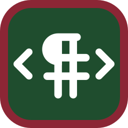

# mdprint

**Markdown → print-quality, self-contained HTML. One static binary.**

<br clear="left">

[](https://crates.io/crates/mdprint)
[](https://github.com/filip-cokesh/mdprint/actions/workflows/ci.yml)
[](#license)

*Česká verze dokumentace: [README.cs.md](README.cs.md)*

**Live demos** — real documents produced by `mdprint --toc --lof --lot`, with
numbered equations and cross-references, captioned tables, code, figures,
typography and dark mode:
[čeština](https://filip-cokesh.github.io/mdprint/) ·
[English](https://filip-cokesh.github.io/mdprint/en.html) ·
[Deutsch](https://filip-cokesh.github.io/mdprint/de.html).
Try printing them (Ctrl+P), or open the **printed PDFs** with page numbers
and a table of contents, list of figures and list of tables with page
references (`mdprint --toc-pages --lof --lot --pdf=all`):
[CS](https://filip-cokesh.github.io/mdprint/doc-cs-normal.pdf) ·
[EN](https://filip-cokesh.github.io/mdprint/doc-en-normal.pdf) ·
[DE](https://filip-cokesh.github.io/mdprint/doc-de-normal.pdf)
(also in small and large type, linked from the demo pages).

## Why

Pandoc is a cannon for this job — a universal converter with a LaTeX toolchain
behind it when you want beautiful PDF. Printing straight from the browser is
the opposite extreme: zero setup, but no typesetting — no widow control, no
non-breaking spaces, tables split mid-row. And no existing tool cares about
Czech microtypography at all. mdprint sits in the middle: one binary turns
a Markdown file into a single HTML file that reads well on the web *and*
prints beautifully from Chrome (Ctrl+P → PDF or paper), with Czech typographic
rules applied by default.

## Install

```
cargo install mdprint
```

or grab a prebuilt binary from [Releases](https://github.com/filip-cokesh/mdprint/releases).

## Quick start

```
mdprint dokument.md
```

This produces `dokument.html` — a single file with all CSS, fonts and
build-time-rendered KaTeX inlined — plus an `img_dokument/` folder with the
referenced images (deduplicated by content hash). Open the HTML anywhere,
print it from Chrome, or publish it as-is.

## Features

- **Single static binary** — no runtime dependencies (a Chrome/Edge only
  for the optional `--pdf` and `--toc-pages`), no JavaScript in the output, fonts (Libertinus, JetBrains Mono) embedded as WOFF2
- **KaTeX math** rendered at build time (`$…$`, `$$…$$`) via a native Rust
  port — invalid TeX fails the build with a line number. KaTeX cannot
  line-break display math, so in print mdprint allows breaks at top-level
  operators and shrinks over-wide formulas in steps so nothing gets
  clipped; for full control use `aligned`/`split` with explicit `\\`
- **Syntax highlighting** — static `<span>`s (syntect); light theme on
  screen and in print, a dark theme (Base16 Ocean Dark) in dark mode
- **Czech, German and English typography** applied on the AST — see below
- **Hyphenation** with embedded Czech, German and English patterns (soft
  hyphens, words ≥ 6 chars, ≥ 3 chars around each break, headings exempt)
- **Print CSS** — A4 page setup, page numbers „3 / 8“ in the footer,
  orphans/widows control, table headers repeated across pages, unbreakable
  figures and table rows, long code lines wrapped with hanging indent, URLs
  printed after external links
- **Page references in the table of contents** (`--toc-pages`) — mdprint
  lays the document out in headless Chrome/Edge in all three font sizes,
  reads the page of every heading from the PDF and writes the numbers into
  the TOC; print picks the set matching the font size you chose
- **PDF export** (`--pdf`, `--pdf=all`) through the same headless browser
- **Equation numbering and cross-references** with LaTeX syntax —
  `\label{eq:x}` in a display formula, `\eqref{eq:x}` / `\ref{x}` /
  `\autoref{x}` in text; labels on figures (`{#fig:x}`) and captioned
  tables (`Table: … {#tbl:x}`); numbers are resolved at build time, so the
  author never types one. See [Cross-references and lists](#cross-references-and-lists)
- **List of figures and list of tables** (`--lof`, `--lot`) at the end of
  the document, with page numbers when `--toc-pages` is on
- **Image handling** — paths resolved relative to the input, copies named
  `<slug>-<hash>`, cleanup driven by a manifest (mdprint never deletes
  anything it didn't create), optional `--fetch` for remote images with
  a disk cache
- **Dark mode and font size without JavaScript** — dark mode follows
  `prefers-color-scheme` with a manual CSS-only toggle (print always stays
  light); an A/A/A switcher picks small/default/large type for both screen
  and print (the controls themselves never print)
- **Template packs** — external branding (logo header, colors, fonts,
  company footer) loaded from a folder at run time, no recompilation

## Typography

The distinguishing feature. Rules are applied only to text nodes (never
code, math or URLs), each rule is a separately tested function, and the
rule set follows the document language (`--lang`, front matter `lang:`).

### Czech (`--lang cs`, default)

Rules follow ČSN 01 6910 and Pecina's *Knihy a typografie*.

| Rule | Before | After |
|---|---|---|
| Non-breaking space after single-letter prepositions | `šel k lesu` | `šel k lesu` (`k` U+00A0 `lesu`) |
| Number–unit binding | `25 °C`, `10 kg`, `100 %` | bound with U+00A0 |
| Abbreviations | `č. 12`, `např. zde` | bound with U+00A0 |
| Initials | `J. K. Tyl` | bound with U+00A0 |
| Dates | `1. 1. 2026`, `5. července` | bound with U+00A0 |
| Czech quotes | `"slovo"`, `'vnořené'` | `„slovo“`, `‚vnořené‘` |
| Dash with spaces | `text - vsuvka` | `text – vsuvka` (NBSP before dash) |
| Number ranges | `10-20`, `1918-1938` | `10–20` (en dash) |
| Ellipsis | `atd...` | `atd…` |
| Multiplication | `2 x 3`, `40x60` | `2 × 3`, `40×60` (hex `0x1F` untouched) |
| Thousands groups | `1 000 000` | narrow NBSP U+202F |
| Apostrophes | `d'Artagnan` | `d’Artagnan` |

### German (`--lang de`)

Rules follow DIN 5008: „Gänsefüßchen“ quotes (‚nested‘ too), protected
spaces inside multi-part abbreviations (`z. B.`, `d. h.`, `i. d. R.`),
references bound to their numbers (`Nr. 5`, `S. 12`, `Abb. 3`),
Gedankenstrich ( – with a protected space before it), en-dash ranges,
`×`, number–unit binding, dates (`1. 1. 2026`, `3. Oktober`), narrow
no-break thousands groups, apostrophes (`geht's` → `geht’s`). Generated
texts are localized (Inhalt, Abb., Version) and the byline date follows
DIN (`04.09.2026`).

### English (`--lang en`)

Chicago-style em dashes (` - `, ` -- `, `--` → `—` closed up), “curly”
quotes with ‘nested’ ones, apostrophes in contractions (`don't` → `don’t`),
en-dash number ranges, `×`, number–unit binding (SI), ellipsis. Thousands
keep their commas; generated texts use Contents and Fig.

## Configuration

Optional `mdprint.toml` next to the input file (or `--config <path>`).
CLI flags override it; every key is optional.

```toml
lang = "cs"                     # cs | en | de; front matter `lang:` overrides this
template = "../my-pack"         # "default" or path to a template pack folder

[paper]
size = "A4"                     # anything valid for CSS @page size
margin = "2.5cm 2cm"

[figures]
prefix = "Obr."                 # figure caption prefix: "Obr. 1: …"
numbering = true
list = false                    # list of figures at the end (--lof)

[tables]
prefix = "Tab."                 # caption prefix for "Table: …" paragraphs
list = false                    # list of tables at the end (--lot)

[equations]
numbering = "labeled"           # labeled | all | none — which $$…$$ get a number

[fonts]                         # primary family overrides (embedded stay as fallback)
serif = "Libertinus Serif"
sans = "Libertinus Sans"
mono = "JetBrains Mono"

[print]
page_numbers = true             # "3 / 8" bottom right (Chrome/Edge 131+)
toc_pages = false               # page numbers in the TOC (needs Chrome/Edge)
font_size = "normal"            # small | normal | large: initial A/A/A and --pdf size
browser = "C:/path/chrome.exe"  # optional; else MDPRINT_BROWSER or auto-detect

[math]                          # math size in em relative to surrounding text
inline = 0.95                   # allowed range 0.5–2.0; defaults calibrated
display = 1.0                   # for Libertinus (page-fit shrink adapts)

[company]                       # footer of a branded template pack;
name = "…"                      # overrides the pack's own defaults
address = "…"
ico = "…"                       # company registration number
dic = "…"                       # VAT number
web = "…"
email = "…"
```

Documents may carry YAML front matter (`title`, `author`, `date`, `version`,
`lang`, `template`, `page_numbers`, `toc_pages`, `font_size`, `lof`, `lot`) — `title` renders a document header, ISO dates are
typeset the Czech way (`2. 9. 2026`), `version` shows in the byline.

A **template pack** is a folder with `pack.toml`, `template.css` and optional
logos (`logo-light.png`, `logo-dark.png`), fonts and footer links
(`[[links]]`: label, URL and an optional SVG/PNG icon from the pack —
monochrome icons invert to white in dark mode); pass it via
`--template <folder>`. The output stays a single HTML file — pack assets are
inlined like the built-in ones. See the pack section in
[README.cs.md](README.cs.md) for the manifest schema, or start from the
forkable starter pack:
**[mdprint-pack-starter](https://github.com/filip-cokesh/mdprint-pack-starter)**.

## CLI reference

```
Usage: mdprint [OPTIONS] <INPUT>

Arguments:
  <INPUT>  Input Markdown file

Options:
  -o, --output <OUTPUT>      Output HTML file (default: next to input, .html)
      --lang <LANG>          Document language [possible values: cs, en, de]
      --toc                  Generate a table of contents (headings 1-3)
      --toc-pages            Add print page numbers to the TOC and lists
                             (implies --toc; needs Chrome or Edge)
      --lof                  List of figures at the end of the document
      --lot                  List of tables (captioned ones) at the end
      --font-size <SIZE>     Initial font size: small | normal | large
      --no-page-numbers      No page numbers in print
      --pdf[=all]            Also write PDF (all = one per font size;
                             needs Chrome or Edge)
      --browser <PATH>       Browser for --pdf/--toc-pages (else
                             MDPRINT_BROWSER or auto-detect)
      --fetch                Download remote images (with a disk cache)
      --config <CONFIG>      Config path (default: mdprint.toml next to input)
      --template <TEMPLATE>  "default" or path to a template pack folder
  -h, --help                 Print help
  -V, --version              Print version
```

Exit code is non-zero on any error; missing images and invalid TeX report
the source line.

## Cross-references and lists

Markdown has no equation numbers, and KaTeX only knows a manual `\tag`.
mdprint resolves LaTeX-style labels at build time, so numbers are never
typed by hand:

```markdown
$$ w_{\max} = \frac{5 q L^4}{384 E I} \label{eq:deflection} $$

Formula \eqref{eq:deflection} rests on … (see \autoref{fig:beam} and \autoref{tbl:data}).

{#fig:beam}

Table: Input data {#tbl:data}

| L | q |
|---|---|
```

- **Equations**: `\label{…}` anywhere in a display formula (`$$…$$`); the
  label is stripped and `\tag{N}` added, typeset by KaTeX on the right.
  By default only labelled equations are numbered (like LaTeX `equation`
  vs. `equation*`); `[equations] numbering = "all"` numbers every display
  formula, with `\notag` / `\nonumber` as opt-out. A formula with its own
  `\tag` keeps it and references show that text. Numbers run through the
  whole document (1, 2, 3 …).
- **Figures**: `{#fig:x}` right after the image (any label name works).
  Figures without a label still get an anchor `fig-N`.
- **Tables**: a paragraph starting with `Table:`, `Tabulka:` or `Tabelle:`
  (accepted in every language) immediately before a table is its caption,
  typeset above the table as "Table 1: …"; a trailing `{#tbl:x}` is the
  label. Tables without a caption are not numbered and not listed.
- **References** in text (outside math): `\ref{x}` → bare number,
  `\eqref{eq:x}` → "(3)", `\autoref{x}` → localized prefix with a
  non-breaking space: *Eq. (3)*, *Fig. 2*, *Table 1* (cs: *rovnice (3)*,
  *Obr. 2*, *Tab. 1*; de: *Gl. (3)*, *Abb. 2*, *Tab. 1*). All become links.
  An unknown or duplicate label, or `\label` inside inline math, fails the
  build with the source line. Labels: letters, digits and `: _ . -`,
  starting with a letter.
- **Lists**: `--lof` / `--lot` (front matter `lof: true`, `lot: true`;
  `[figures] list`, `[tables] list`) append *List of Figures* / *List of
  Tables* (*Seznam obrázků* / *Seznam tabulek*, *Abbildungsverzeichnis* /
  *Tabellenverzeichnis*) after the body — on a new page in print. With
  `--toc-pages` they get page numbers from the same measurement as the TOC.

### Page numbers — what to expect

- The footer number is a CSS `@page` margin box: Chrome and Edge 131+ print
  it, Safari and Firefox currently omit it (nothing breaks).
- TOC page numbers are measured, not estimated: three headless renders (one
  per font size) take a few seconds. They are exact for printing from
  Chrome/Edge with the document's paper size and margins at 100 % scale.
  Another browser or a changed scale in the print dialog may shift them;
  `--pdf` output always matches.
- Turn off the browser's own *Headers and footers* in the print dialog —
  Chrome then leaves the footer to mdprint.
- Without a browser, `--toc-pages` warns and writes the TOC without numbers;
  `--pdf` fails. Everything else still needs no runtime dependency.

## Build from source

```
cargo build --release
cargo test
```

Pure Rust, no C dependencies — `syntect` runs with the `default-fancy`
feature (fancy-regex instead of oniguruma), so cross-platform builds need
nothing beyond a Rust toolchain (MSRV 1.88).

## Security

mdprint is a build tool for **your own documents** and trusts its inputs:
raw HTML in Markdown passes through to the output, image paths (including
absolute ones and `..`) are read from your filesystem and copied next to
the output, and template packs are code-equivalent (their CSS and fonts
land in every page). Do not run it on untrusted Markdown, configs or
packs — and see [SECURITY.md](SECURITY.md) for reporting vulnerabilities.

Supply chain: release binaries carry GitHub build provenance attestations
(`gh attestation verify mdprint-<version>-<target>.zip --repo filip-cokesh/mdprint`),
crates.io releases are published through Trusted Publishing from the tagged
CI run (no long-lived tokens), and every workflow action is pinned to a
commit SHA with Dependabot keeping the pins current.

## License

Licensed under either of [MIT](LICENSE-MIT) or
[Apache-2.0](LICENSE-APACHE), at your option. Bundled fonts and KaTeX assets
keep their own licenses — see [THIRD-PARTY-LICENSES](THIRD-PARTY-LICENSES).
